# SecSea badge — every screen

Generated by `tools/badge_screens.py --lang en` (screenshots of the badge in English through its serial port, user and admin modes). The language is chosen in Settings > Language ([translation](translation.md)).

*Version française : [tous les écrans](../fr/ecrans.md).*

## Menu

### Home — The main menu

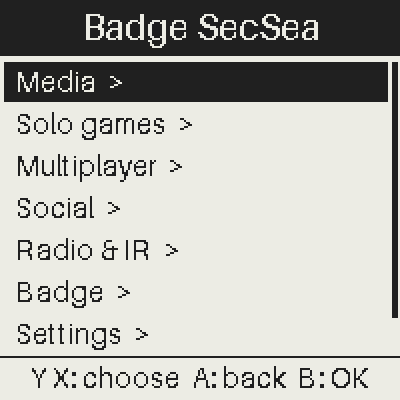

## Media

### Menu — The theme Media

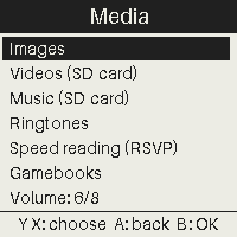

### Images

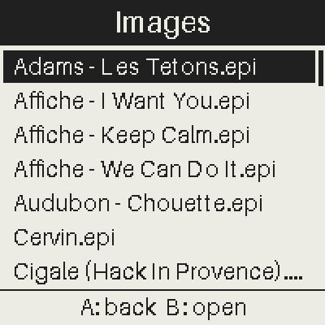

### Images — An image of the SD card

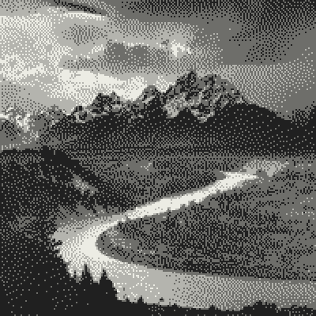

### Videos

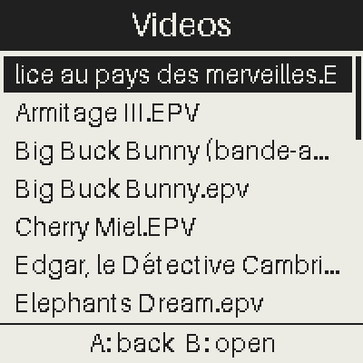

### Videos — Playing a video

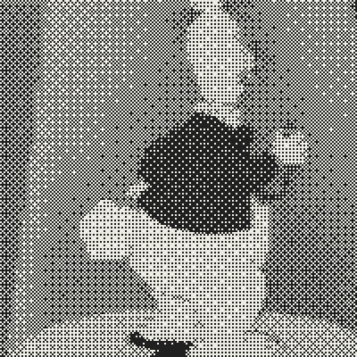

### Music

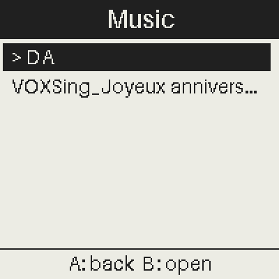

### Music — A folder of music

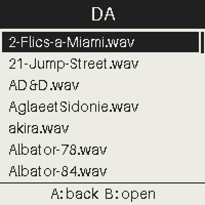

### Music — Playing a music

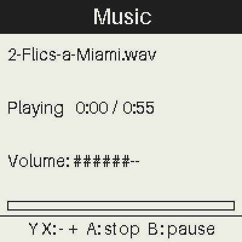

### Ringtones

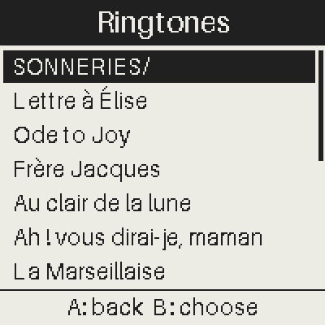

### Ringtones — A ringtone

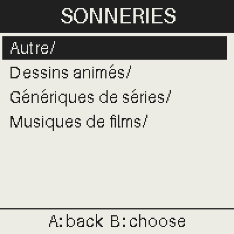

### Speed reading

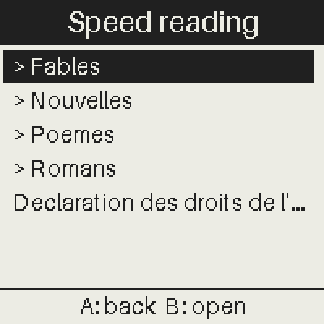

### Speed reading — A folder of texts

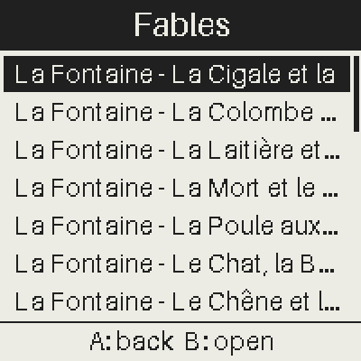

### Speed reading — Reading a text

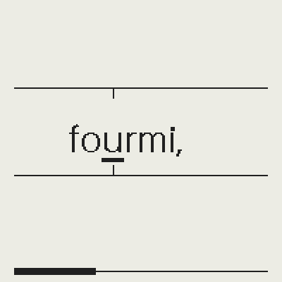

### Gamebooks

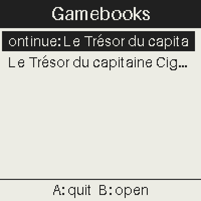

### Gamebooks — A book

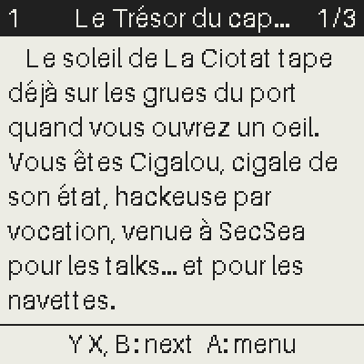

### Gamebooks — Reading

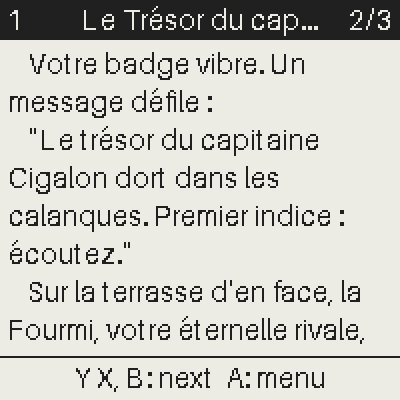

## Solo games

### Menu — The theme Solo games

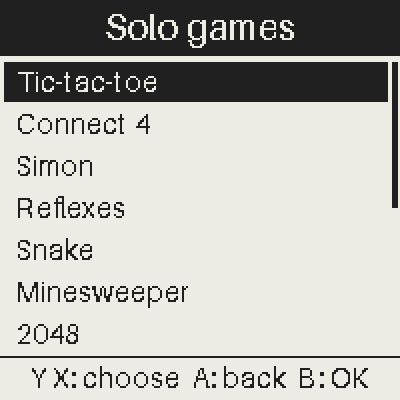

### Tic-tac-toe

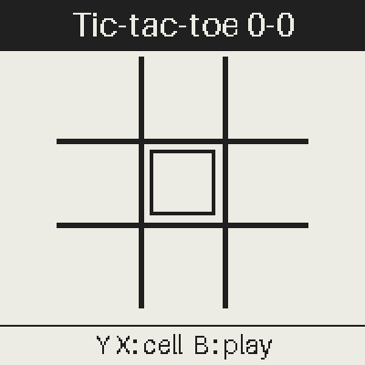

### Tic-tac-toe — The game

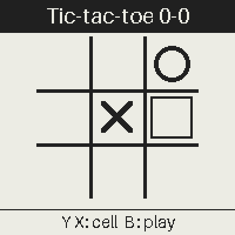

### Connect 4

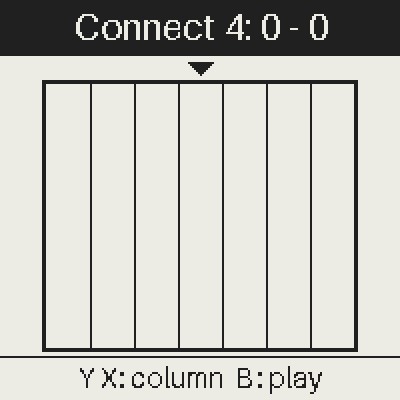

### Connect 4 — The game

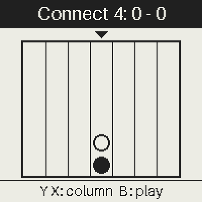

### Simon

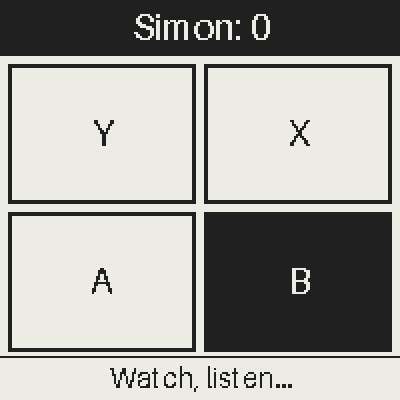

### Simon — The game

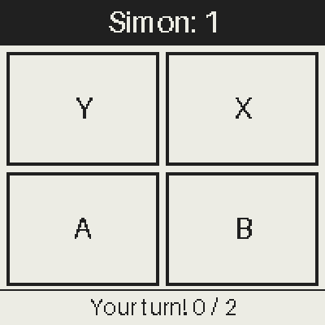

### Reflexes

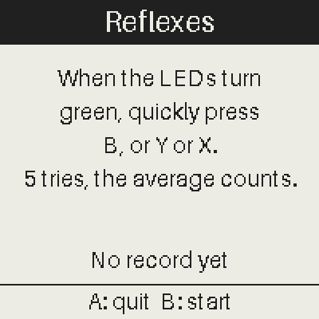

### Reflexes — The game: wait for the signal (the LEDs)

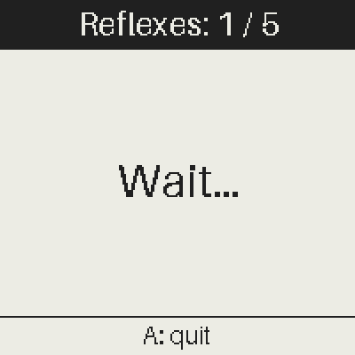

### Reflexes — The reaction time

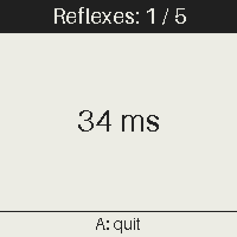

### Snake

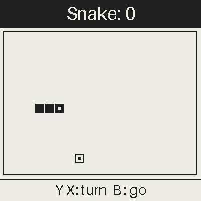

### Snake — The game

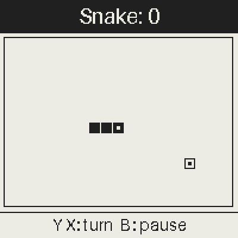

### Snake — Game over (into the wall)

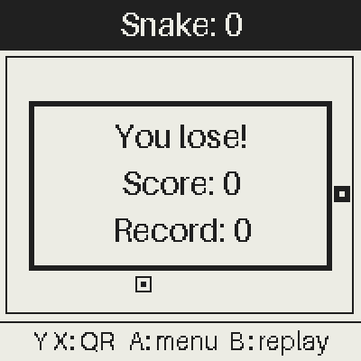

### Snake — The score as a QR code (signed)

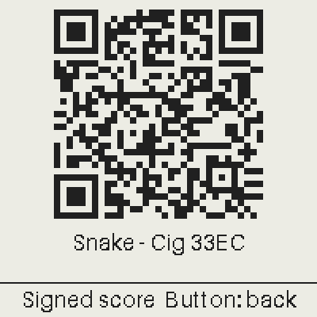

### Minesweeper

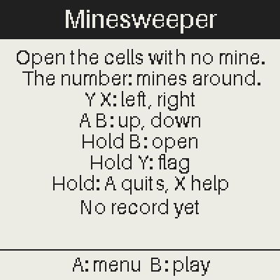

### Minesweeper — The game

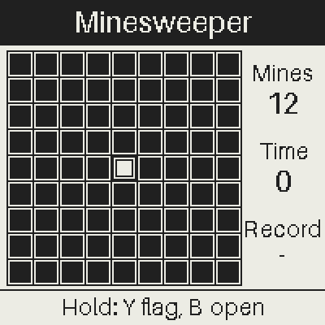

### 2048

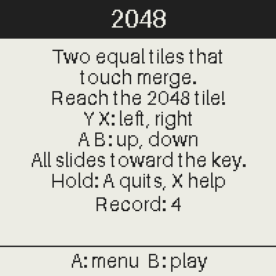

### 2048 — The game

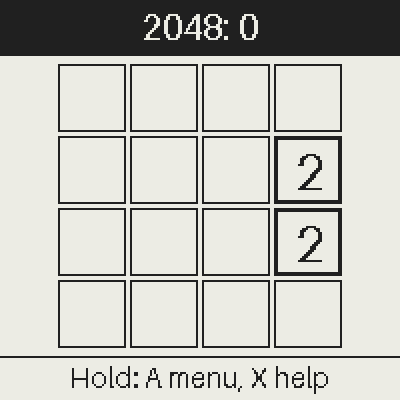

### 15 puzzle

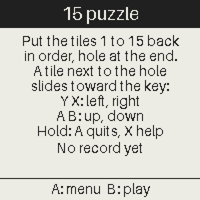

### 15 puzzle — The game

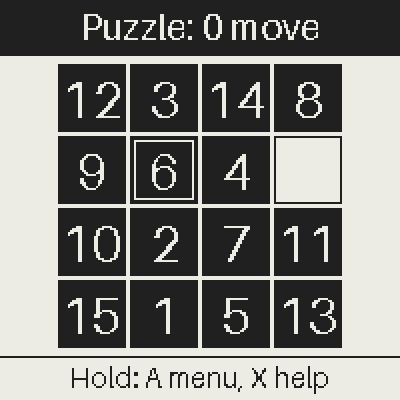

### Sokoban

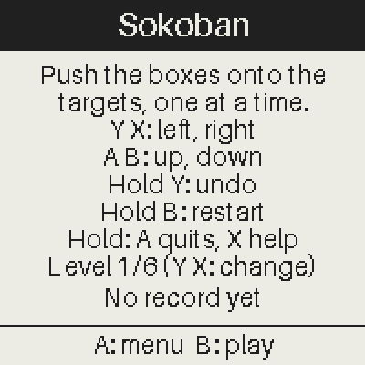

### Sokoban — The game

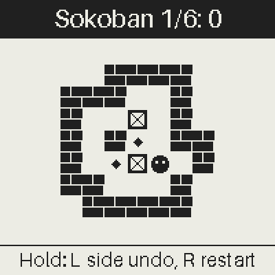

### Mastermind

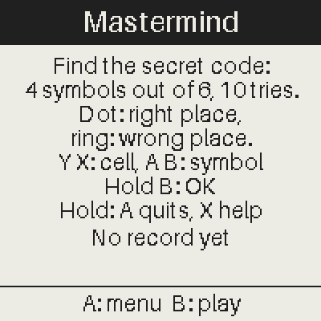

### Mastermind — The game

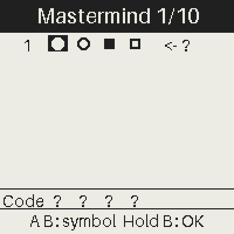

### Hangman

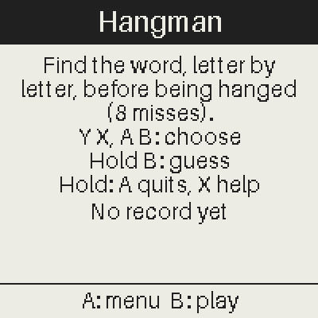

### Hangman — The game

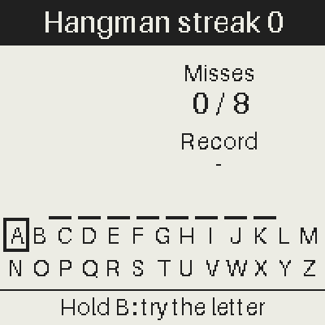

### Blind test

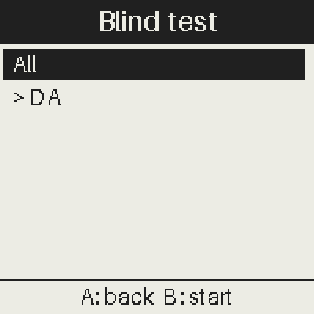

### Blind test — A track: guess the title

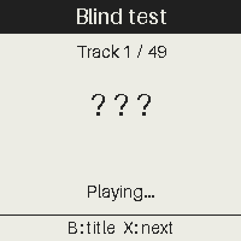

### Blind test — The answer

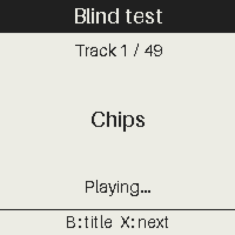

### CTF

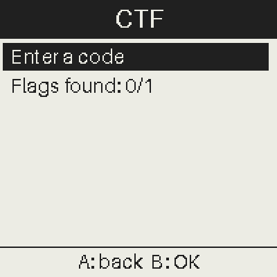

### CTF — Typing a code

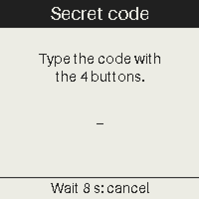

### Crypto CTF

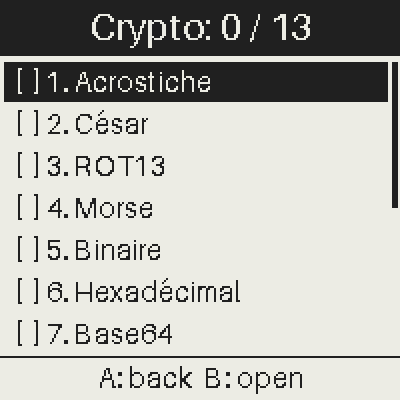

### Crypto CTF — A challenge

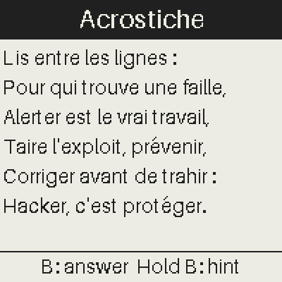

### Crypto CTF — Its hint

### Crypto CTF — Typing the answer

### Crypto CTF — The final flag

## Multiplayer

### Menu — The theme Multiplayer

### Duel

### Battleship

### Werewolf

### Werewolf — Leading a game

### Werewolf — Help: a role card

### Werewolf — Help: the role in detail

### Werewolf — Role: Werewolf

### Werewolf — Role: Werewolf: details

### Werewolf — Role: Seer

### Werewolf — Role: Seer: details

### Werewolf — Role: Witch

### Werewolf — Role: Witch: details

### Werewolf — Role: Hunter

### Werewolf — Role: Hunter: details

### Werewolf — Role: Cupid

### Werewolf — Role: Cupid: details

### Werewolf — Role: Little girl

### Werewolf — Role: Little girl: details

### Werewolf — Role: Thief

### Werewolf — Role: Thief: details

### Werewolf — Role: Captain

### Werewolf — Role: Captain: details

### Werewolf — Role: Lovers

### Werewolf — Role: Lovers: details

### Assassin

### Tug of war

### Micro racers

### Micro racers — Create a party: the waiting room

### Micro racers — Join a party: the search

## Social

### Menu — The theme Social

### Cicada network

### Messages

### Messages — Choosing the recipient

### Messages — Choosing the message

### Contacts

### Contacts — My card (checked fields: sent)

### Contacts — Typing a field

### Contacts — Exchanging the cards

### Contacts — Contacts received

### Skills

### Skills — My skills

### Skills — Who shares them?

### Vote

### Vote — A cicada voting (the other one chose another answer)

### Cicada radar

### Hot - cold

### Cicada virus

### Chorus

### Announcements

### Smuggling

### Smuggling — The hold

### Cicada detector

## Radio & IR

### Menu — The theme Radio & IR

### Carrier

### 433 MHz decoder

### Weather station

### Send an image

### Receive an image

### Infrared

### 433 MHz hunt

### Listen to pirate radio

## Badge

### Menu — The theme Badge

### Name tag

### Lamp

### Lamp — The lamp off (B)

### Talk badge

### Talk badge — Green: all is well

### Talk badge — Orange: 5 min

### Talk badge — Red: time is up

### OLED screen

### Achievement

### Achievement — The meetings

### Achievement — Achievement: First steps

### Achievement — Achievement: Hello!

### Achievement — Achievement: Sociable

### Achievement — Achievement: Network star

### Achievement — Achievement: Postman

### Achievement — Achievement: Business card

### Achievement — Achievement: Citizen

### Achievement — Achievement: Chorister

### Achievement — Achievement: Patient

### Achievement — Achievement: Remedy

### Achievement — Achievement: Duellist

### Achievement — Achievement: Admiral

### Achievement — Achievement: Full moon

### Achievement — Achievement: Survivor

### Achievement — Achievement: Shadow

### Achievement — Achievement: Last standing

### Achievement — Achievement: Strongman

### Achievement — Achievement: Hero

### Achievement — Achievement: Music lover

### Achievement — Achievement: Smuggler

### Achievement — Achievement: Treasure

### Achievement — Achievement: Collector

### Achievement — Achievement: Hacker

### Achievement — Achievement: Cryptographer

### Achievement — Achievement: Sleuth

### Achievement — Achievement: Wave hunter

### Achievement — Achievement: Champion

### Achievement — Achievement: Movie buff

### Achievement — Achievement: Photographer

### Achievement — Achievement: Expert

### Achievement — Achievement: Soulmates

### Achievement — Achievement: Platinum

### Achievement — Rank 1

### Achievement — Rank 2

### Achievement — Rank 3

### Achievement — Rank 4

### Achievement — Rank 5

### Achievement — Rank 6

### Achievement — Rank 7

### Achievement — Rank 8

### Achievement — Rank 9

### Achievement — Rank 10

### My rank

### Sound ID

### Conference badge

## Settings

### Menu — The theme Settings

### Screensaver

### Language

### Info

### Credits

### Credits — Page 2

### Credits — Page 3

### Credits — Page 4

### Credits — Page 5

### Credits — Page 6

### Credits — Page 7

### Credits — Page 8

### Radio tuning

### Battery by radio

## Admin

### Menu — The theme Admin

### Radio commands

### Cicada LEDs

### Cicada LEDs — The mode

### Cicada LEDs — The blink times

### Cicada LEDs — The fade times

### Cicada LEDs — Send / restore

### Notices (admin)

### Notices (admin) — An announcement: its fields

### Notices (admin) — Typing the time

### Notices (admin) — Typing the text (accented letters)

### Notices (admin) — Preview (the screen of the cicadas)

### Vote (admin)

### Vote (admin) — The result of the two cicadas voting

### Chorus: start

### Hot-cold beacon

### Virus: patient 0

### Smuggling (admin)

### Smuggling (admin) — Goods: Cheese

### Smuggling (admin) — Goods: Salted fish

### Smuggling (admin) — Goods: Lemons

### Smuggling (admin) — Goods: Olives

### Smuggling (admin) — Goods: Figs

### Smuggling (admin) — Goods: Navettes

### Smuggling (admin) — Goods: Bottle of rum

### Smuggling (admin) — Goods: Pastis

### Smuggling (admin) — Goods: Saucisson

### Smuggling (admin) — Goods: Lavender

### Smuggling (admin) — Goods: Marseille soap

### Smuggling (admin) — Goods: Barrel of rum

### Smuggling (admin) — Goods: Calissons

### Smuggling (admin) — Goods: Saffron

### Smuggling (admin) — Goods: Pepper

### Smuggling (admin) — Goods: Vanilla

### Smuggling (admin) — Goods: Compass

### Smuggling (admin) — Goods: Spyglass

### Smuggling (admin) — Goods: Treasure map

### Smuggling (admin) — Goods: Chest key

### Smuggling (admin) — Goods: Black pearl

### Smuggling (admin) — Goods: Purse of doubloons

### Smuggling (admin) — Goods: The gold cicada

### Smuggling (admin) — Goods: The crystal skull

### Smuggling (admin) — Goods: The learned parrot

### Werewolf (admin)

### Reset

### Reset — The confirmation

### Battery (calibration)

### Pirate radio

### Pirate radio — The settings

### Badge type

### Cicada batteries

### Battery (auto)

### Battery drain

## Texts to fix

(none)

## Rows of lists shortened (previews: the page of the row shows it all)

- Médias > Images : list row cut "Cigale (Hack In Provence).epi"
- Médias > Vidéos : list row cut "Alice au pays des merveilles.EPV"
- Médias > Vidéos : list row cut "Big Buck Bunny (bande-annonce).epv"
- Médias > Vidéos : list row cut "Edgar, le Détective Cambrioleur.EPV"
- Médias > Musique : list row cut "VOXSing_Joyeux anniversaire (ID 2194)_LaSonotheque.fr.wav"
- Médias > Lecture rapide : list row cut "Declaration des droits de l'homme (1789).txt"
- Médias > Lecture rapide > Un dossier de textes : list row cut "La Fontaine - La Cigale et la Fourmi.txt"
- Médias > Lecture rapide > Un dossier de textes : list row cut "La Fontaine - La Colombe et la Fourmi.txt"
- Médias > Lecture rapide > Un dossier de textes : list row cut "La Fontaine - La Laitière et le Pot au lait.txt"
- Médias > Lecture rapide > Un dossier de textes : list row cut "La Fontaine - La Mort et le Bûcheron.txt"
- Médias > Lecture rapide > Un dossier de textes : list row cut "La Fontaine - La Poule aux oeufs d'or.txt"
- Médias > Lecture rapide > Un dossier de textes : list row cut "La Fontaine - Le Chat, la Belette et le petit Lapin.txt"
- Médias > Lecture rapide > Un dossier de textes : list row cut "La Fontaine - Le Chêne et le Roseau.txt"
- Médias > Livres-jeux : list row cut "Continue: Le Trésor du capitaine Cigalon"
- Médias > Livres-jeux : list row cut "Le Trésor du capitaine Cigalon"
- Médias > Livres-jeux > Un livre : list row cut "Le Trésor du capitaine Cigalon"
- Médias > Livres-jeux > La lecture : list row cut "Le Trésor du capitaine Cigalon"
- Badge > Badge conférence : list row cut "SSTIC 2026 - Symposium sur la sécurité des te"
- Badge > Badge conférence : list row cut "THCon 2026 - Toulouse Hacking Convention"
- Badge > Badge conférence : list row cut "leHACK 2026 - Brave New World"
- Admin > Annonces (admin) : list row cut "14:45 @Maurice : On est tous dans l'annuaire"
- Admin > Annonces (admin) : list row cut "15:30 SYSTEM_IDLE : Pause"
- Admin > Annonces (admin) : list row cut "16:45 @Skilo : How I dumped Bob s Firmware"
- Admin > Annonces (admin) : list row cut "17:30 Ilyes Azouni : Biométrie : usurper un visage"
