# Badge SecSea — tous les écrans

Généré par `tools/badge_screens.py` (captures du badge par le port série, mode utilisateur et admin).

*English version: [every screen](../en/screens.md).*

## Menu

### Accueil — Le menu principal

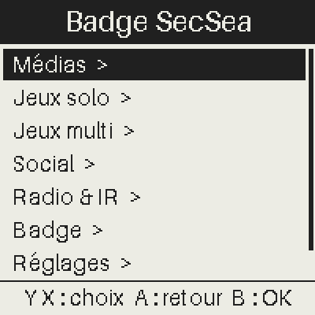

## Médias

### Menu — Le thème Médias

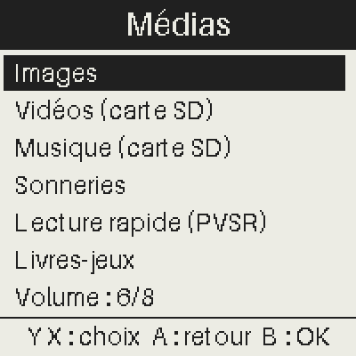

### Images

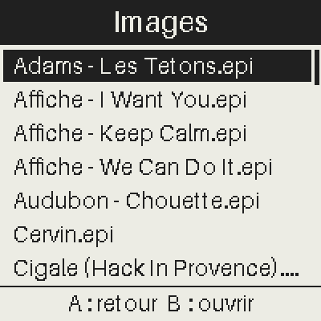

### Images — Une image de la carte SD

### Vidéos

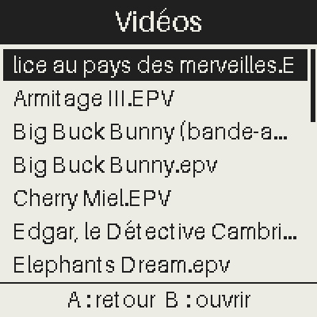

### Vidéos — Lecture d'une vidéo

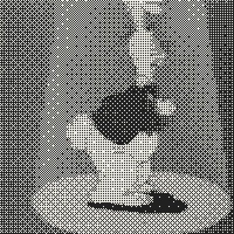

### Musique

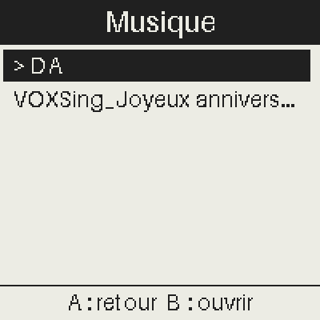

### Musique — Un dossier de musiques

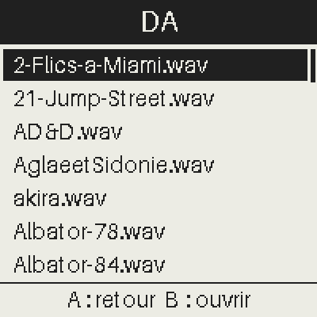

### Musique — Lecture d'une musique

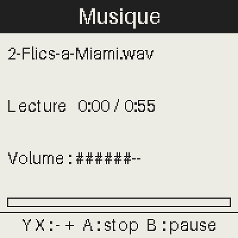

### Sonneries

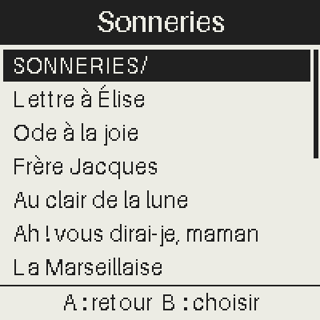

### Sonneries — Une sonnerie

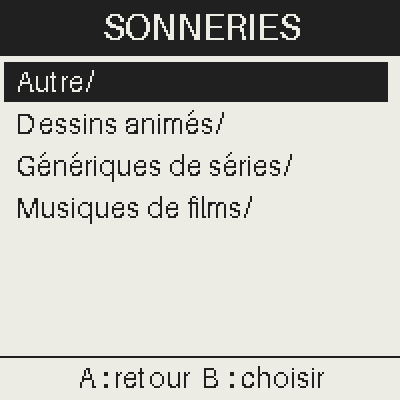

### Lecture rapide

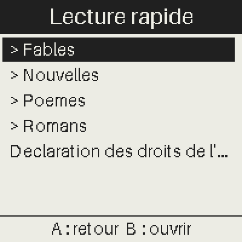

### Lecture rapide — Un dossier de textes

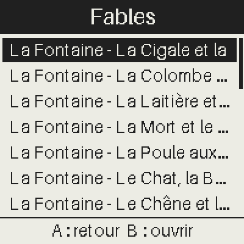

### Lecture rapide — Lecture d'un texte

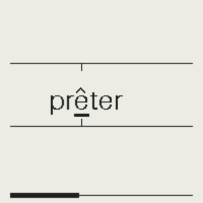

### Livres-jeux

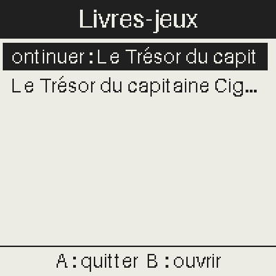

### Livres-jeux — Un livre

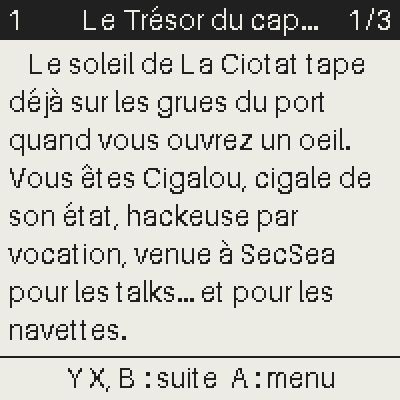

### Livres-jeux — La lecture

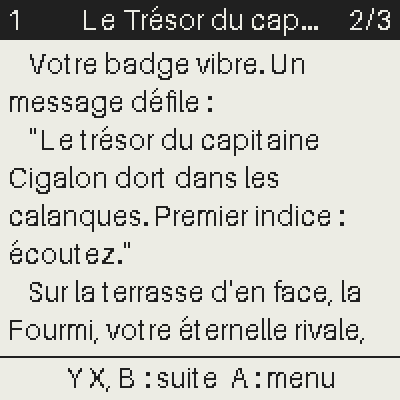

## Jeux solo

### Menu — Le thème Jeux solo

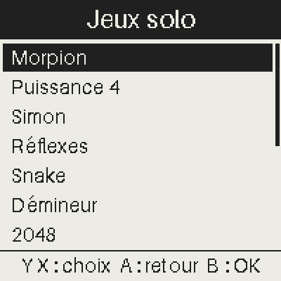

### Morpion

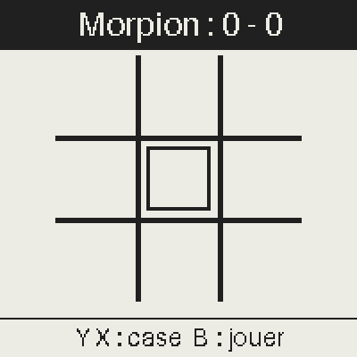

### Morpion — La partie

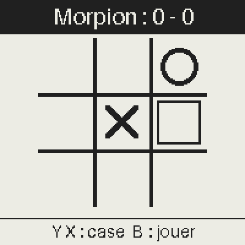

### Puissance 4

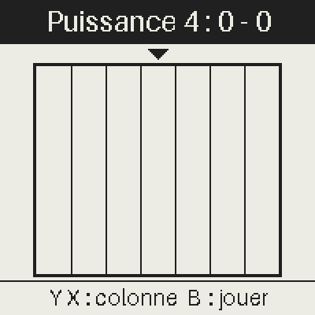

### Puissance 4 — La partie

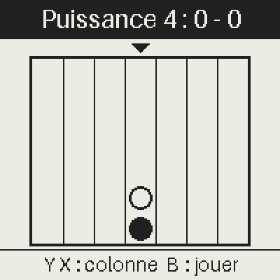

### Simon

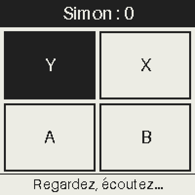

### Simon — La partie

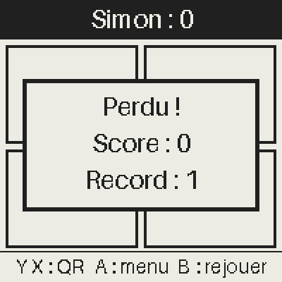

### Réflexes

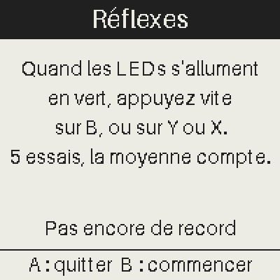

### Réflexes — La partie : attendre le signal (les LEDs)

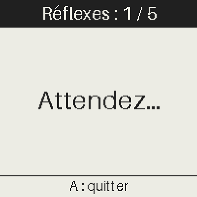

### Réflexes — Le temps de réaction

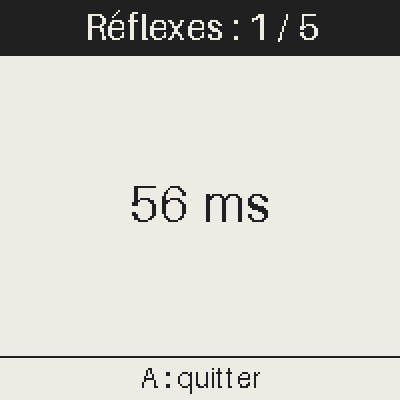

### Snake

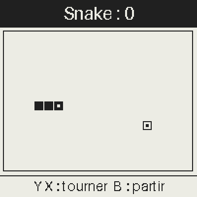

### Snake — Fin de partie (dans le mur)

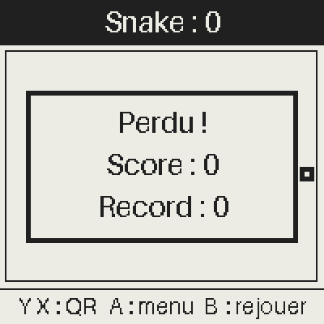

### Snake — Le score en QR code (signé)

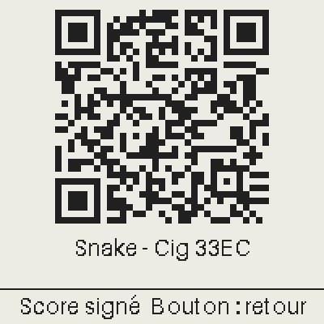

### Démineur

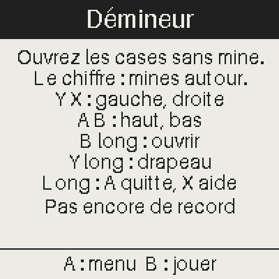

### Démineur — La partie

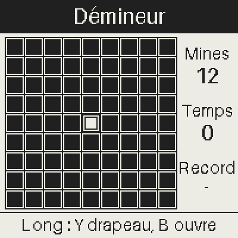

### 2048

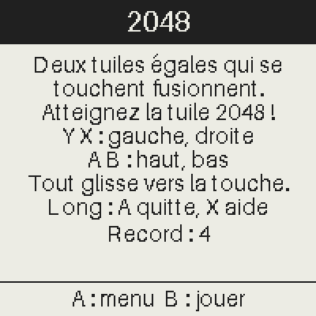

### 2048 — La partie

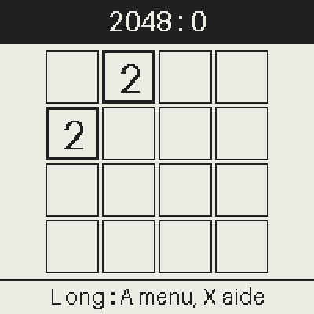

### Taquin

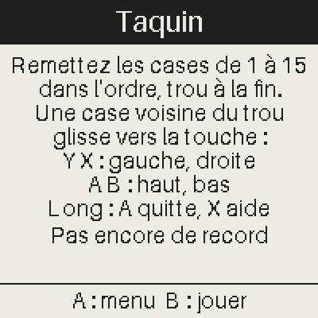

### Taquin — La partie

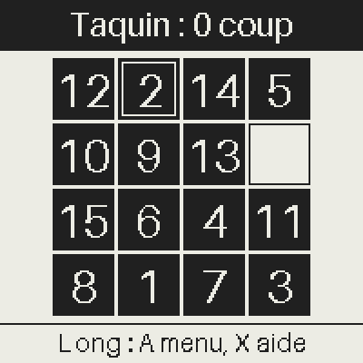

### Sokoban

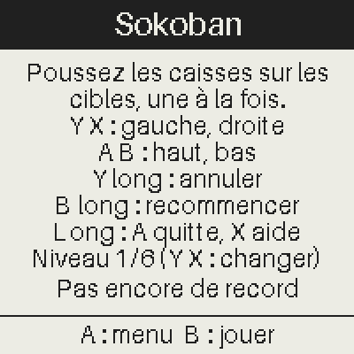

### Sokoban — La partie

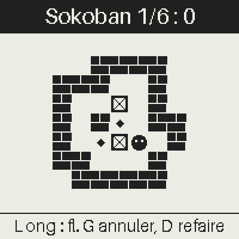

### Mastermind

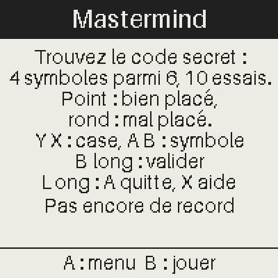

### Mastermind — La partie

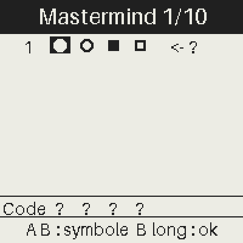

### Pendu

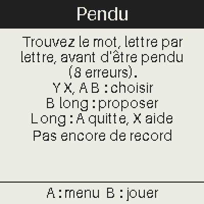

### Pendu — La partie

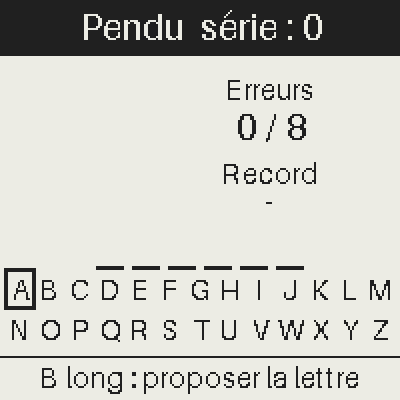

### Blind test

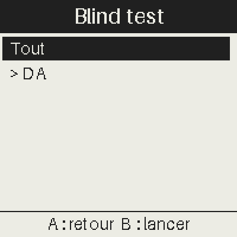

### Blind test — Un morceau : deviner le titre

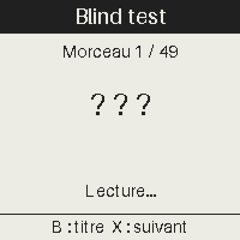

### Blind test — La réponse

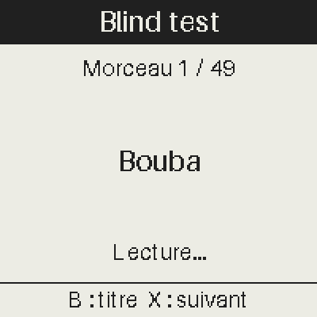

### CTF

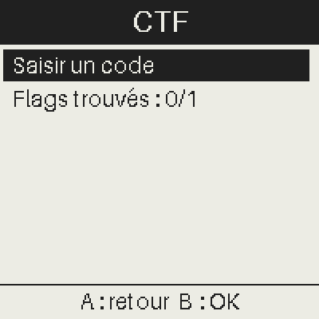

### CTF — Saisie d'un code

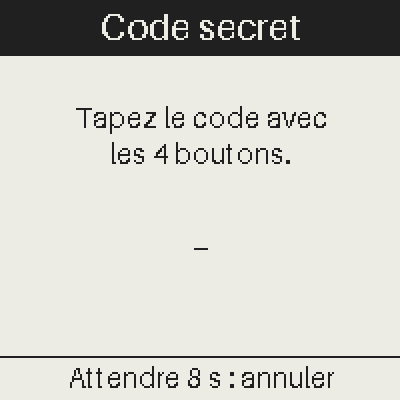

### Défis crypto

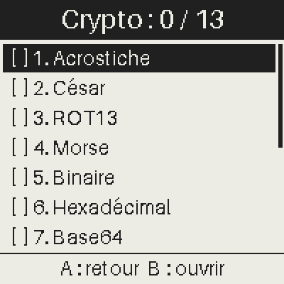

### Défis crypto — Un défi

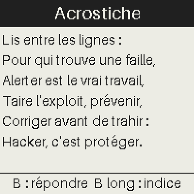

### Défis crypto — Son indice

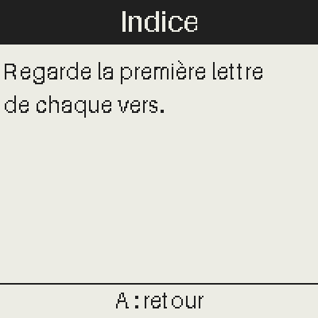

### Défis crypto — La saisie de la réponse

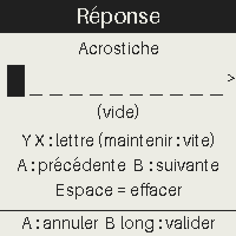

### Défis crypto — Le flag final

## Jeux multi

### Menu — Le thème Jeux multi

### Duel

### Duel — Un duel : choisir pierre, feuille ou ciseaux

### Duel — Le résultat de la manche

### Bataille navale

### Bataille navale — Une bataille : la grille de tir

### Loup-garou

### Loup-garou — Mener une partie

### Loup-garou — Aide : une carte de rôle

### Loup-garou — Aide : le détail du rôle

### Loup-garou — Rôle : Loup-garou

### Loup-garou — Rôle : Loup-garou : détail

### Loup-garou — Rôle : Voyante

### Loup-garou — Rôle : Voyante : détail

### Loup-garou — Rôle : Sorcière

### Loup-garou — Rôle : Sorcière : détail

### Loup-garou — Rôle : Chasseur

### Loup-garou — Rôle : Chasseur : détail

### Loup-garou — Rôle : Cupidon

### Loup-garou — Rôle : Cupidon : détail

### Loup-garou — Rôle : Petite fille

### Loup-garou — Rôle : Petite fille : détail

### Loup-garou — Rôle : Voleur

### Loup-garou — Rôle : Voleur : détail

### Loup-garou — Rôle : Capitaine

### Loup-garou — Rôle : Capitaine : détail

### Loup-garou — Rôle : Amoureux

### Loup-garou — Rôle : Amoureux : détail

### Assassin

### Tir à la corde

### Tir à la corde — Une partie : la corde pendant que les équipes tirent

### Tir à la corde — Le résultat de la partie

### Mini-bolides

### Mini-bolides — Créer une partie : la salle d'attente

### Mini-bolides — Rejoindre une partie : la recherche

### Mini-bolides — Une course : sa voiture (encadrée), l'autre, les points de passage

## Social

### Menu — Le thème Social

### Réseau cigales

### Réseau cigales — Changer le nom de la cigale (B)

### Messages

### Messages — Choix du destinataire

### Messages — Choix du message

### Contacts

### Contacts — Ma carte (champs cochés : envoyés)

### Contacts — Saisie d'un champ

### Contacts — Echange des cartes

### Contacts — Contacts reçus

### Compétences

### Compétences — Mes compétences

### Compétences — Qui les partage ?

### Vote

### Vote — Une cigale qui vote (l'autre a choisi une autre réponse)

### Radar des cigales

### Chaud - froid

### Virus des cigales

### Choeur

### Annonces

### Contrebande

### Contrebande — La cale

### Détecteur de cigales

## Radio & IR

### Menu — Le thème Radio & IR

### Porteuse

### Décodeur 433 MHz

### Station météo

### Envoyer une image

### Recevoir une image

### Infrarouge

### Chasse 433 MHz

### Écouter la radio pirate

## Badge

### Menu — Le thème Badge

### Badge nominatif

### Lampe

### Lampe — La lampe éteinte (B)

### Badge de talk

### Badge de talk — Vert : tout va bien

### Badge de talk — Orange : 5 min

### Badge de talk — Rouge : fini

### Écran OLED

### Succès

### Succès — Les rencontres

### Succès — Succès : Premiers pas

### Succès — Succès : Bonjour !

### Succès — Succès : Sociable

### Succès — Succès : Star du réseau

### Succès — Succès : Facteur

### Succès — Succès : Carte de visite

### Succès — Succès : Citoyen

### Succès — Succès : Choriste

### Succès — Succès : Patient

### Succès — Succès : Remède

### Succès — Succès : Duelliste

### Succès — Succès : Amiral

### Succès — Succès : Pleine lune

### Succès — Succès : Survivant

### Succès — Succès : Ombre

### Succès — Succès : Dernier debout

### Succès — Succès : Costaud

### Succès — Succès : Héros

### Succès — Succès : Mélomane

### Succès — Succès : Contrebandier

### Succès — Succès : Trésor

### Succès — Succès : Collectionneur

### Succès — Succès : Hacker

### Succès — Succès : Cryptographe

### Succès — Succès : Fin limier

### Succès — Succès : Chasseur d'ondes

### Succès — Succès : Recordman

### Succès — Succès : Cinéphile

### Succès — Succès : Photographe

### Succès — Succès : Expert

### Succès — Succès : Âmes soeurs

### Succès — Succès : Platine

### Succès — Grade 1

### Succès — Grade 2

### Succès — Grade 3

### Succès — Grade 4

### Succès — Grade 5

### Succès — Grade 6

### Succès — Grade 7

### Succès — Grade 8

### Succès — Grade 9

### Succès — Grade 10

### Mon grade

### Identifiant sonore

### Badge conférence

## Réglages

### Menu — Le thème Réglages

### Veille de l'écran

### Langue

### Infos

### Crédits

### Crédits — Page 2

### Crédits — Page 3

### Crédits — Page 4

### Crédits — Page 5

### Crédits — Page 6

### Crédits — Page 7

### Crédits — Page 8

### Réglage radio

### Batterie par radio

## Admin

### Menu — Le thème Admin

### Commandes radio

### LEDs des cigales

### LEDs des cigales — Le mode

### LEDs des cigales — Les temps du clignotement

### LEDs des cigales — Les temps du fondu

### LEDs des cigales — Envoyer / rétablir

### Annonces (admin)

### Annonces (admin) — Une annonce : ses champs

### Annonces (admin) — Saisie de l'heure

### Annonces (admin) — Saisie du texte (lettres accentuées)

### Annonces (admin) — Aperçu (l'écran des cigales)

### Vote (admin)

### Vote (admin) — Le résultat des deux cigales qui votent

### Choeur : lancer

### Balise chaud-froid

### Virus : patient zéro

### Contrebande (admin)

### Contrebande (admin) — Marchandise : Fromage

### Contrebande (admin) — Marchandise : Poisson salé

### Contrebande (admin) — Marchandise : Citrons

### Contrebande (admin) — Marchandise : Olives

### Contrebande (admin) — Marchandise : Figues

### Contrebande (admin) — Marchandise : Navettes

### Contrebande (admin) — Marchandise : Bouteille de rhum

### Contrebande (admin) — Marchandise : Pastis

### Contrebande (admin) — Marchandise : Saucisson

### Contrebande (admin) — Marchandise : Lavande

### Contrebande (admin) — Marchandise : Savon de Marseille

### Contrebande (admin) — Marchandise : Tonneau de rhum

### Contrebande (admin) — Marchandise : Calissons

### Contrebande (admin) — Marchandise : Safran

### Contrebande (admin) — Marchandise : Poivre

### Contrebande (admin) — Marchandise : Vanille

### Contrebande (admin) — Marchandise : Boussole

### Contrebande (admin) — Marchandise : Longue-vue

### Contrebande (admin) — Marchandise : Carte au trésor

### Contrebande (admin) — Marchandise : Clé du coffre

### Contrebande (admin) — Marchandise : Perle noire

### Contrebande (admin) — Marchandise : Bourse de doublons

### Contrebande (admin) — Marchandise : La cigale d'or

### Contrebande (admin) — Marchandise : Le crâne de cristal

### Contrebande (admin) — Marchandise : Le perroquet savant

### Loup-garou (admin)

### Remise à zéro

### Remise à zéro — La confirmation

### Batterie (calibration)

### Radio pirate

### Radio pirate — Les réglages

### Type du badge

### Batteries des cigales

### Batterie (auto)

### Vider la batterie

