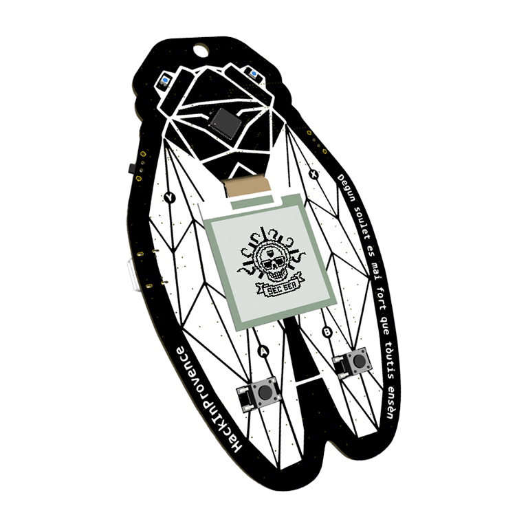
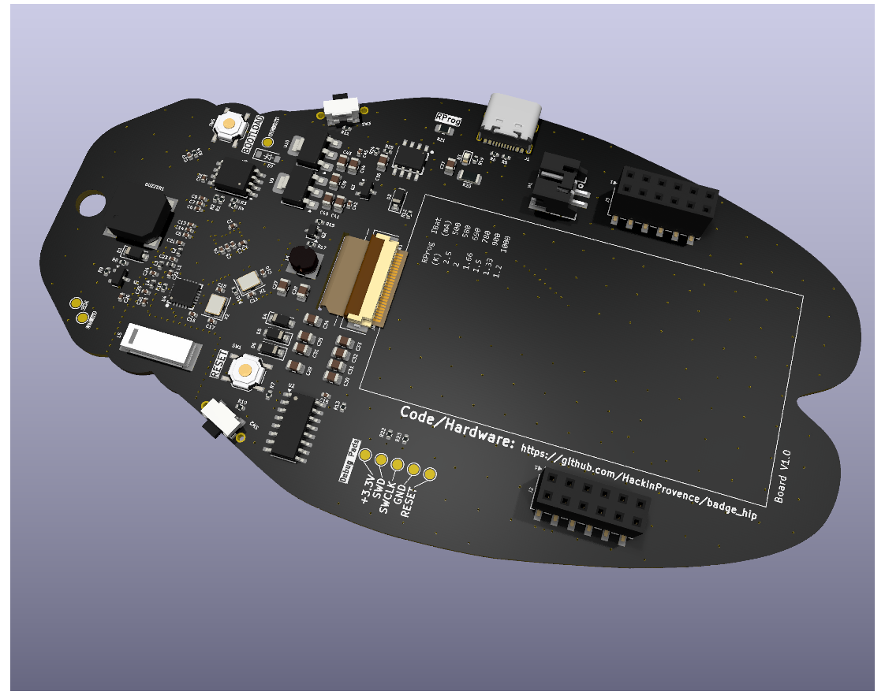
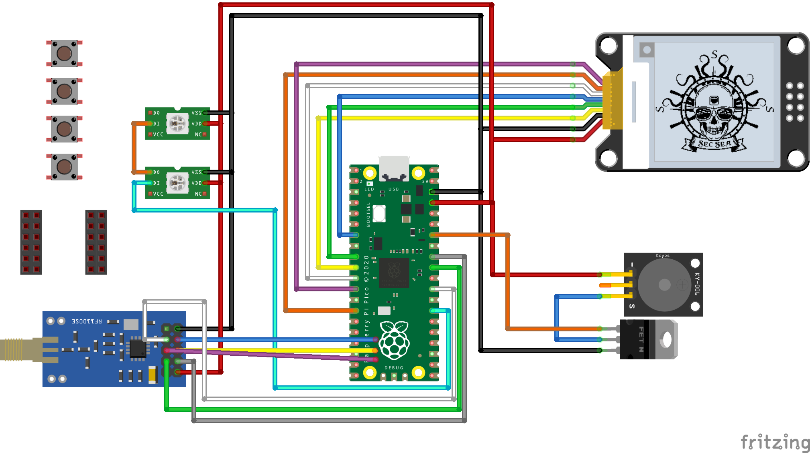
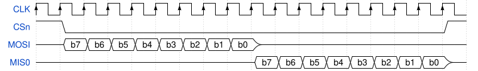

# Présentation du badge

Le badge utilise le coeur du Raspberry Pi Pico (RP2040),
et utilise ses nombreuses fonctionnalités pour connecter d'autres modules matériels :

- flash 16Mo,
- 4 boutons,
- 1 buzzer,
- 2 LEDs WS2812 (yeux de la cigale),
- gestion charge batterie,
- radio CC1101 en SPI,
- écran e-Paper 200x200 en SPI,
- possibilité d'ajouter d'autres modules via GPIO, I2C et un chipselect sur SPI0.





Voici une vue schématique et **inexacte** du badge que l'on construit
(inexacte car nous partons du RP2040 au lieu d'un pico et tout n'y est pas connecté) :



Presque tous les pins d'entrée/sortie sont utilisés.
Ceux restant sont exposés sur les ports d'extension.

Le RP2040 est un microcontrôleur conçu par Raspberry.
Il abrite 2 coeurs Cortex M0+ cadencés à 125MHz, mais seulement 264ko de RAM.
Il contient des périphériques hardware bien pratiques : PWM, UART, I2C, SPI, Timers.

Un périphérique remarquable et unique en son genre est le PIO.
Le PIO exécute un programme dans son langage proche de l'assembleur,
et dont chaque instruction s'exécute en 1 cycle.
Il peut piloter des IO à de multiples cadences et peut implémenter des protocoles électriques aux exigences variées,
comme le WS2812, sans consommer de temps CPU.
Il s'adapte à des temps de l'ordre de la milliseconde jusqu'aux nanosecondes (125MHz -> 8ns).

Le RP2040 sur le badge est compatible avec le SDK utilisé pour le Pico.
Le badge est flashé de la même manière que le pico (fichiers UF2, bouton BOOTSEL).
D'une manière générale, ils sont compatibles, même si leurs GPIO n'auront pas les mêmes rôles.


## SP quoi ? Communication MCU <-> périphériques

Au niveau le plus haut, on peut voir la communication entre le coeur et les autres modules comme ceci :

```
                                      
                                      
   ┌───────┐           ┌──────────┐   
   │       │           │          │   
   │  MCU  │◄─────────►│  Module  │   
   │       │           │          │   
   └───────┘           └──────────┘   
                                      
                                      
```

Un ou plusieurs fils les relient et ils échangent des données dessus par des signaux électriques.

Il existe une multitude (infinité ?) de manière de communiquer.
Souvent en électronique, cette communication se fait en binaire en faisant varier la tension sur un fil (0 = 0V, 1 = 3.3V ou 5V).
L'un définit la tension sur le fil, l'autre écoute.

Il existe deux familles de communications : en série (les bits/bauds arrivent les uns à la suite des autres, e.g. UART, SPI, USB, ...)
ou en parallèle (les bits sont transmis en même temps sur plusieurs fils, e.g. PCI, RAM, ...).


### UART

L'UART (et ses ancêtres comme le RS-232) est un protocole série Asynchrone.
Il y a un fil de communication dans chaque sens :

```
                                      
                                      
   ┌───────┐Tx       Rx┌──────────┐   
   │       ├──────────►│          │   
   │  MCU  │           │  Module  │   
   │       │◄──────────┤          │   
   └───────┘Rx       Tx└──────────┘   
                                      
                                      
```

Le timing de communication, en bauds par seconde, et d'autres paramètres sont définis à l'avance.
On peut schématiser par exemple la transmission d'un octet :


### SPI

Le SPI est un autre protocole série très répandu.
C'est un bus de données où plus de deux modules peuvent communiquer.
Le Contrôleur (souvent appelé Maître) commande un ou plusieurs Périphériques (Slaves).

Il fonctionne avec 1 ligne d'horloge (SCK, CLK),
1 ligne Contrôleur vers Périphériques (COPI, MOSI),
1 ligne Périphériques vers Contrôleur (CIPO, MISO),
1 ligne de sélection par périphérique (CSn) :

```
                                          
                               ┌────────┐ 
                    ┌─────────►│        │ 
                    │ ┌───────►│  Mod1  │ 
 ┌────────────┐     │ │ ┌──────┤        │ 
 │        CLK ├─────┤ │ │ ┌───►│        │ 
 │        MOSI├─────┼─┤ │ │ CSn└────────┘ 
 │  MCU   MISO│◄────┼─┼─┤ │               
 │        CSn1├─────┼─┼─┼─┘               
 │        CSn2├─────┼─┼─┼─┐    ┌────────┐ 
 └────────────┘     └─┼─┼─┼───►│        │ 
                      └─┼─┼───►│  Mod2  │ 
                        └─┼────┤        │ 
                          └───►│        │ 
                            CSn└────────┘ 
                                          
```

La CLK sert à synchroniser les échanges.
Les CSn servent à cibler la commande donnée sur MOSI à l'un ou l'autre des périphériques
(ceux qui ne sont pas sélectionner doivent ignorer ce qu'ils reçoivent).
C'est toujours le Contrôleur qui choisit le CSn et initie la communication.
Il y a également plusieurs modes de communication, suivant qu'on lit la donnée sur le front montant ou descendant de l'horloge,
que l'horloge reste active entre communications, ...

Voici un exemple où le Contrôleur envoie un octet et le Périphérique répond un octet :




### WS2812

Ce protocole est répandu pour contrôler les LEDs RGB.
Il n'utilise qu'un fil.
C'est un protocole série en cascade : chaque LED garde les 24 premiers bits qu'elle reçoit
mais fait passer tous les bits suivants aux autres LEDs.

Ce protocole est plus difficile à représenter, car les 0 et 1 ne sont pas simplement encodés par le signal niveau bas ou haut,
et l'encodage du 0 et du 1 n'ont pas la même durée.
Le 0 est encodé par un signal niveau haut pendant 350ns puis un signal bas pendant 800ns (à +/- 150ns),
alors que le 1 est encodé par haut 700ns puis bas 600ns.

Pour que la première LED puisse savoir qu'on s'adresse à elle de nouveau (et non à une suivante),
on doit laisser le signal à bas pendant au moins 50µs (50 000ns).

Le pilotage des LEDs est souvent un problème pour les microcontrôleur,
car par exemple 200 LED nécessitent 260µs pendant lesquels il faut respecter un timing précis.

Si on le fait faire par un CPU via du logiciel, on appelle ça du bit banging.
Dans le cas d'un microcontrôleur avec OS, comme les Raspberry Pi, c'est un challenge que le programme ne soit jamais interrompu par l'OS,
qui est par nature multi-tâches.
On obtient des clignotements des premières LEDs, ou on n'arrive jamais au bout du ruban...
Avec un Arduino, on peut monopoliser son attention pour réussir la programmation, mais on ne peut rien faire d'autre pendant ce temps.

Avec le RP2040, on peut programmer le PIO pour réaliser ces mises à jour (presque) sans consommer de temps CPU.
Le PIO s'occupe de gérer les timings sur le fil de signal pendant que le CPU pousse les données à envoyer.
Le CPU est interrompu lorsqu'on peut envoyer de nouvelles données mais cette opération est très rapide pour le CPU.
On peut même configurer le DMA pour faire cette opération à la place du CPU et ne plus être interrompu.


## Configuration du MCU : les registres

Le MCU est un système déjà complexe, composé de plusieurs coeurs et de périphériques :

```
┌────────────────────────────────────────────────────┐         
│  RP2040                               ┌──────────┐ │         
│                                       │          ├─┼───► CLK 
│                                       │  Driver  ├─┼───► MOSI
│                                  ┌───►│   SPI    │◄┼──── MISO
│                                  │    │          ├─┼───► CSn 
│ ┌─────────┐                      │    └──────────┘ │         
│ │         │         ┌───────┐    │                 │         
│ │  Core0  │◄───────►│       │◄───┘    ┌──────────┐ │         
│ │         │         │       │         │          │ │         
│ └─────────┘         │   B   │         │  Driver  ├─┼───► Tx  
│                     │   U   │◄───────►│   UART   │◄┼──── Rx  
│                     │   S   │         │          │ │         
│ ┌─────────┐         │       │         └──────────┘ │         
│ │         │◄───────►│       │◄───┐                 │         
│ │  Core1  │         └───────┘    │    ┌──────────┐ │         
│ │         │                      │    │          │ │         
│ └─────────┘                      └───►│   ...    │ │         
│                                       │          │ │         
│                                       └──────────┘ │         
│                                                    │         
└────────────────────────────────────────────────────┘         
```

Les drivers sont des composants hardware qui réalisent une activité sans intervention des coeurs de calcul.
En plus de ceux cités, on peut ajouter le PWM, le DMA (Direct Memory Access) pour réaliser des transferts de données,
l'I2C, l'UART, des Timers, une RealTimeClock, l'USB, ...
Toutes ces fonctions sont détaillées dans la [datasheet du RP2040](https://datasheets.raspberrypi.com/rp2040/rp2040-datasheet.pdf)

Au niveau logiciel, la configuration de ces drivers est abstraite.
Il serait trop compliqué et trop lent d'inventer encore un protocole pour communiquer avec le bus,
qui est relié à chaque sous module.

A la place, on utilise des *registres* de configuration.
Pour le logiciel, il s'agît d'un espace mémoire comme un autre, accessible en lecture et/ou écriture.
Les accès sur ces registres sont traduites par le bus pour configurer les drivers des modules.

Par exemple, écrire 1 sur le bit 0 de l'adresse 0x50200000 met en route une machine à état du PIO.
Lire 32 bits de l'adresse 0x50200020 enlève et renvoie ces 4 octets de la fil d'attente d'une machine à état du PIO.
Ou encore, écrire 12 bits sur 0x4005002c règle la cadence du PWM pour les GPIO 4 et 5.

Tous ces registres ont des noms dans la datasheet du RP2040,
et dans le SDK en C qui contient également des fonctions pour faciliter leur usage,
d'où l'intérêt d'utiliser le SDK...


# Activités

## Prise en main de la toolchain

Nous écrirons nos programmes en C.
Des programmes en MicroPython sont disponibles sur le net,
ainsi que les explications pour les exécuter.

Prenez le temps d'installer le SDK pour pouvoir compiler et flasher votre pico/badge.
Il y a deux options principales :

- utiliser VSCode (Windows ou Linux) et les extensions Raspberry Pi Pico et CMake Tools,
- utiliser le SDK via CMake (principalement Linux).

Les instructions d'installation sont résumées dans le [README du projet](../README.md#pico-c-sdk).


## Compilation des programmes existants

Compiler le projet et pousser l'exécutable de calibration :

```bash
# A côté de src
mkdir -p build
cd build
cmake .. -GNinja -DPICO_BOARD=badge_secsea -DPICO_STDIO_USB=1 -GNinja
cmake --build . --target all
# Brancher le pico, mettre en position OFF, tenir le bouton bootloader, passer en ON, lacher BOOTLOADER
picotool load src/tests/radio_calibrate.uf2
picotool reboot
```

Utiliser un terminal série pour voir le résultat de la calibration.
A faire dans les 30 secondes, sinon faire un OFF/ON pour relancer une calibration.
J'utilise `minicom` :

```bash
minicom -D /dev/ttyACM0
minicom -D /dev/serial/by-id/usb-Raspberry_Pi_Pico_...  # Accès par son nom unique (serial)
```


## La cigale

Le son de la cigale est générée aléatoirement et à la volée et jouée sur le buzzer.
C'est le PIO qui pilote le buzzer dans ce cas.
Le choix de timing correspondant à des fréquences autour de 6 à 8 kHz reproduit les cigales.

L'exécutable à flasher est `build/src/tests/test_noise_gen.uf2` dont les sources sont en [`tests/noise_gen.c`](../src/tests/noise_gen.c).
Il se base sur la bibliothèque [`src/noise_gen/noise_gen.c`](../src/noise_gen/noise_gen.c).

Changez les timings et tentez de faire une meilleure cigale !


## Musique

La bibliothèque [`src/music/music.c`](../src/music/music.c) donne une base pour programmer une mélodie et la jouer.
C'est à voir comme un instrument midi, ou une boîte à musique.

Il n'y a qu'un instrument et le son produit est un carré typique des années 90.

Le test correspondant est `build/src/tests/test_music.uf2` dont la source est [`tests/music.c`](../src/tests/music.c).
Programmez vos propres musiques !

Pour la musique, imaginez comment modifier la lib pour passer une callback dans `userdata` géré par `alarm`.
Ainsi, on peut compter les notes, et laisser la possibilité de synchroniser d'autres éléments avec le son :

- les LEDs,
- les paroles sur l'UART.

On pourrait concevoir un système similaire pour `noise_gen`.
Il s'agît surtout de séparer les silences des bruits...

Il y a d'autres manières de jouer de l'audio sur un buzzer,
en particulier en utilisant le PWM pour générer un signal haute fréquence que le buzzer filtre,
pour un rendu plus fidèle.
En revanche, ceci consomme beaucoup plus de mémoire pour stocker le son (16ko/seconde).
La branche `dev-LLM` propose une bibliothèque pour jouer ces sons.


## Pilotage de LEDs (WS2812)

C'est un exemple typique d'une bonne utilisation du module PIO du CPU.
Les WS2812 ont un protocole monofil un peu particulier qui demande des timings précis de l'ordre de la µs.
Réaliser ces temporisations avec les coeurs du CPU demanderaient des mécanismes complexes (interruption),
ou d'attendre sans rien faire d'autre pour faire changer le signal au bon moment (bit banging).
Avec le PIO, on envoie les données qui sont transmises au LED avec le bon timing.

C'est la bibliothèque `src/leds` qui s'en occupe, avec les tests associées `src/tests/leds.c` et le binaire `build/src/tests/test_leds.uf2` pour tester.

Si vous vous intéressez au fonctionnement du PIO,
commencez par regarder et comprendre comment fonctionne la partie C,
qui pilote le PIO.
Le PIO est une machine à états.
Notez la fonction `pio_sm_put_blocking`, il s'agît de la fonction poussant les données au PIO.

Essayez diverses couleurs.
Essayez de faire "vibrer" les yeux de la cigale.

Idéalement, avec le son émit par `noise_gen`...


## Pilotage écran e-Paper

La bibliothèque `src/screen` gère l'affichage d'images sur l'écran.
Cette bibliothèque est un peu plus complexe.
Mais les fonctionnalités principales sont abstraites dans `screen_show_image_bw` et `screen_show_image_4g`.
Voir le test correspondant `src/tests/screen.c` pour voir un exemple d'utilisation.

Le principe est de pousser un ou deux plans de bits.
Un pour le noir et blanc, deux pour les 4 niveaux de gris.

Pour les images noir et blanc, on pack 8 pixels par octet,
puis on pousse ça vers l'écran pour affichage.

Pour les images 4 niveaux de gris, on a deux plans séparés.
Un premier plan dit de "poids fort" qui décide si la couleur du pixel sera entre les deux teintes les plus claires ou les plus sombres,
puis un second plan de "poids faible" qui décide la teinte plus claire ou plus sombre parmi les deux sélectionnée du poids fort.

Le script `src/image2epaper.py` gère le dédoublement des plans et l'encodage en array qu'on peut inclure dans un programme.
Il faut :

- mettre l'image dans `src/tests/imgs/` (2 ou 4 couleurs, png ou webp, gère également les animations webp),
- mentionner son nom dans `src/CMakeLists.txt`,
- l'`#include "name.h"`,
- les plans seront nommés `name_bw` pour une image 2 couleurs et `name_lsb` ou `name_msb` pour les 4 couleurs (lsb = least significant bits = plan des bits de poids faible).

Pousser une image comme un QR code avec votre carte de visite format vCard par exemple.


## Pilotage RF (CC1101)

Le module RF CC1101 est un peu plus compliqué à piloter.
Il nécessite beaucoup de paramètres pour fonctionner.

La bibliothèque `src/radio` est à l'état de prototype.
Il est possible de piloter la radio, mais il est difficile de recevoir des données de manière pratique.

Il existe des pré-réglages pour facilier le travail,
ainsi que l'exécutable de test `src/tests/radio_source.c` qui illustre comment s'en servir.
Cette partie est en train d'être abstraite dans `src/radio/dispatcher.c` mais c'est un travail en cours.

L'intérêt de `radio_source` (que j'abrège RaSo dans la suite) est de fournir un pont entre l'USB et les radio fréquences.
En effet, avec le programme `src/tests/radio_source.py` (`.py` cette fois),
on peut piloter la radio pour la régler (avec les pré-réglages que j'ai utilisé jusqu'ici),
et faire transiter des messages.

La radio étant la même que celle du flipper, on peut communiquer relativement facilement avec celui-ci.
Par exemple, l'application Enhanced SubGHz Chat fonctionne avec le preset "fsk" ou "gfsk" à une vitesse de 10kbauds.

Essayer d'envoyer des messages au flipper et inversement.
Pour l'instant, RaSo n'affiche que les messages en hexa sur le lien série (utiliser minicom).


## Challenge de Samy

D'autres réglages sont possibles pour la radio CC1101.
En fait, du coup, tout ce que sait faire le flipper...

Essayez de craquer la machine à golden ticket de Samy en utilisant le badge en mode RaSo.
Renseignez-vous sur le protocole à utiliser et configurer le RaSo en ajoutant un preset à `src/tests/radio_source.py`.


## Les cigales se rencontrent

L'idée suivante derrière la radio est de faire un "ping" de cigales.
Il faut toujours garder en tête que tout le monde parle sur le même canal,
et qu'il faut laisser des temps d'onde libre pour que les autres puissent parler.
Essayez de ne jamais dépasser 1/1000 du temps sur des messages cyclique (par exemple, pas plus de 1ms toute les 1s).

J'ai plusieurs idées pour le ping de cigales, non encore implémentées :

- utiliser la radio en 100kbps pour éviter de charger les ondes -> à debugger car ça ne fonctionne pas très bien pour l'instant,
- avoir un ping du master qui diffuse une synchro d'horloge,
- chaque badge utilise son numéro de série modulo 997 pour se réserver un temps de parole (2ms toutes les 2s),
- sur ce créneau (à 100kbps, ça représente 200 bits = 25 octets),
  on pourrait envoyer un ping avec par exemple son numéro de série
  (il faut inclure le CRC, le synch word, et le préambule dans les 25 octets)

Quand les cigales sont proches, elles reçoivent le ping avec un sueil sur le niveau de réception,
et déduisent qu'il faut chanter toutes ensemble !


## Diffusion du programme et de vidéos

L'écran eInk supporte jusqu'à 10 images par secondes.
Chaque image en mode vidéo est un seul plan de bits, soit 200\*200 bits = 40kb.
Il faudrait donc atteindre 400kbps sur la radio pour pouvoir transmettre le flux vidéo.
Ce n'est pas fait.

On peut également utiliser pour diffuser des images fixes, comme le programme de la conférence.
On pourrait aller plus lentement (eg 50kbps) et transférer des images via `radio_source.py`.

Si les cigales sont "connectées" et chantent, ce serait bien de pouvoir diffuser un signal "silence",
par exemple dans les salles de conférences.


## Unleashed

La branche `dev-LLM` de ce dépot apporte beaucoup d'ajouts et transforment le badge en mini flipper.

Cette branche contient également des challenges (réalisés, comme son nom l'indique, avec des LLM).
Un setup CTFd avec un push automatique des challenges réalisés a été réalisé,
mais pas encore testé.
